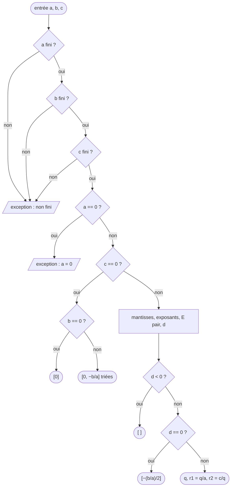

# Rapport : tester le solveur du second degré (INF563, chapitres III à V)

**Devoir.** Reprendre le TP de l'équation du second degré avec JUnit 5 : stratégie **pairwise** sur nos **neuf
catégories de valeurs**, tests paramétrés (`@ParameterizedTest`, `@MethodSource`), chargement de l'implémentation
par **réflexion** ; projet **Maven** avec **JaCoCo** (couverture) et **PIT** (mutation, diapo 138).

**Système sous test** g = `racines(a, b, c)` de l'interface `SolveurSecondDegre` : racines réelles triées de
a·x² + b·x + c = 0 ; tableau vide si Δ < 0, une racine si Δ = 0 ; `IllegalArgumentException` si a = 0 ou si un
coefficient vaut NaN ou ±∞. Implémentations : `SolveurNaif` (formule du lycée), `SolveurStable` (formule stable +
mise à l'échelle, livrée) et, côté tests, `SolveurStableDiapo54` (la version stable d'origine, voir § 4).
Outils : Java 21, Maven 3.9.11 (wrapper), JUnit 5.13.4, AssertJ 3.27.3, JaCoCo 0.8.12, PIT 1.15.3.

| Résultat | Valeur |
|---|---|
| `mvnw verify` (version stable) | **158 tests, 0 échec** : 142 (suite) + 11 (réflexion) + 5 (générateur pairwise) |
| Pairwise | **81 cas au lieu de 9³ = 729**, chaque paire de valeurs couverte exactement une fois |
| Couverture JaCoCo de `SolveurStable` | **100 %** des instructions (182), des branches (16) et des lignes (19) |
| Score de mutation PIT | **38 / 39 = 97 %** ; 1 mutant équivalent justifié → 38 / 38 = 100 % hors équivalents |
| Version naïve (`-Pnaif`) | 142 tests, **28 échecs voulus** (les oracles la détectent) |

## 1. Réflexion : tester une implémentation sans dépendre de sa classe

Les tests ne connaissent que l'interface `SolveurSecondDegre` et un **nom** de classe (une chaîne). `ChargeurSolveur`
(src/test) charge et instancie la classe à l'exécution :

1. `Class.forName(nom)` : le texte devient un objet `Class` (aucune dépendance à la compilation) ;
2. contrôle du contrat : `SolveurSecondDegre.class.isAssignableFrom(classe)`, ni interface ni classe abstraite ;
3. `classe.asSubclass(SolveurSecondDegre.class).getConstructor().newInstance()` : constructeur public sans argument ;
4. toute erreur (`ClassNotFoundException`, `NoSuchMethodException`, `InvocationTargetException`…) devient une
   `IllegalArgumentException` au message explicite : le test se termine en **ERROR**, pas en FAIL.

La suite `SuiteOraclesSolveur` reçoit le nom dans son constructeur ; trois sous-classes ne font que le fournir :
`SolveurStableTest` (`"inf563.solveur.SolveurStable"`), `SolveurNaifTest` (`@Tag("naif")`) et
`SolveurConfigurableTest`, qui lit la propriété `-Dsolveur.impl` (un profil Maven s'active tout seul avec elle).
On teste donc le code d'un camarade **sans écrire ni recompiler un test** :
`.\mvnw.cmd test "-Dsolveur.impl=inf563.solveur.SolveurCamarade"`. `ChargeurSolveurTest` vérifie le chargeur
lui-même (11 tests : 2 classes acceptées, instance neuve à chaque appel, 5 classes refusées avec leur motif, 3 noms vides).

## 2. Oracles et tolérances (chapitre III)

**Mesure d'erreur** N = |y − RA| / |RA| (erreur relative) : les racines vont de 10⁻³⁰⁰ à 10³⁰⁰, une tolérance absolue
n'aurait de sens à aucune de ces échelles (diapo 70). **Tolérance** Tol = c·κ·ε avec ε = 2⁻⁵², c = 10 et
κ = (|a|r² + |b||r| + |c|) / (|r|·|2ar + b|), conditionnement de la racine r. RA calculés à 1 200 chiffres.

| # | DE (a, b, c) | Diagnostic | κ | 10·κ·ε | Tol retenue |
|---|---|---|---|---|---|
| 1 | (1, −3, 2) | cas nominal | 6 | 1,3·10⁻¹⁴ | 2·10⁻¹⁴ |
| 2 | (1, 10⁸, 1) | élimination catastrophique | 2 | 4,4·10⁻¹⁵ | 5·10⁻¹⁵ |
| 3 | (1, 10²⁰⁰, 1) | b² déborde en +∞ | 2 | 4,4·10⁻¹⁵ | 5·10⁻¹⁵ |
| 4 | (10²⁰⁰, −3·10²⁰⁰, 2·10²⁰⁰) | ∞ − ∞ = NaN | 6 | 1,3·10⁻¹⁴ | 2·10⁻¹⁴ |
| 5 | (10⁻²⁰⁰, 1, 10⁻²⁰⁰) | absorption | 2 | 4,4·10⁻¹⁵ | 5·10⁻¹⁵ |
| 6 | (−2, 3, 5) | a négatif | 1,43 | 3,2·10⁻¹⁵ | 4·10⁻¹⁵ |
| 7 | (1, −2, 1) | racine double exacte | ∞ | — | 0 (Δ = 0 calculé sans arrondi) |
| 8 | (1, −2, 1 − 1,1·10⁻¹⁶) | Δ ≈ 0, **mal conditionné** | 1,9·10⁸ | 4,2·10⁻⁷ | 5·10⁻⁷ |

Oracles sans RA : résidu ≤ 8·ε·(|a|r² + |b·r| + |c|) (erreur inverse), Viète, métamorphiques (échelle 2¹⁰ et
opposé, égalité stricte), construction (et 20 cas générés), différentiel BigDecimal.

## 3. Pairwise sur les neuf catégories de valeurs (chapitre IV)

**Catégories** (`CategorieReel`) : les classes usuelles des réels de la diapo 93, un représentant chacune.

| Catégorie | Représentant | a | b | c |
|---|---|---|---|---|
| négatif | −3,7 | ✓ | ✓ | ✓ |
| positif | 2,5 | ✓ | ✓ | ✓ |
| zéro signé | −0,0 | ✕ (a = 0) | ✓ | ✓ |
| très petit | 10⁻³⁰⁰ | ✓ | ✓ | ✓ |
| très grand | 10³⁰⁰ | ✓ | ✓ | ✓ |
| valeur spéciale | NaN | ✕ | ✕ | ✕ |
| non représentable | 0,1 | ✓ | ✓ | ✓ |
| entier > 2⁵³ | 9 007 199 254 740 993 (→ 2⁵³) | ✓ | ✓ | ✓ |
| valeur entière | 3,0 | ✓ | ✓ | ✓ |

**Génération** (`Pairwise`) : exhaustif = 9³ = 729 cas. Pairwise = chaque paire de valeurs de deux paramètres au
moins une fois : il faut au moins 9 × 9 = 81 cas, et 81 suffisent avec le tableau orthogonal L81(9³) construit par un
carré latin : cas (i, j) = (V[i], V[j], V[(i + j) mod 9]). Paires (a, b) : tous les (i, j) ; (a, c) et (b, c) :
à i (resp. j) fixé, (i + j) mod 9 prend les 9 valeurs. `PairwiseTest` vérifie ces propriétés sur les données
(81 cas, 3 × 81 paires chacune une fois, chaque catégorie 9 fois par paramètre).

**Test** `pairwise(CategorieReel, CategorieReel, CategorieReel)` : `@ParameterizedTest` + `@MethodSource("casPairwise")`.
Les cas étant générés, l'oracle aussi : `ReferenceExacte` calcule **Δ exactement** en BigDecimal (le nombre de racines
est sûr), les racines par la formule stable à 40 chiffres arrondies au double (±∞ ou 0 si la vraie racine sort des
double), et Tol = 10·κ·ε par racine (10·√ε pour une racine double). Sous MIN_NORMAL ≈ 2,2·10⁻³⁰⁸ (sous-normaux)
l'écart est rapporté à MIN_NORMAL : ce plancher est 10³⁰⁸ fois plus petit que le `max(1, |RA|)` de la diapo 70 et
ne masque aucune erreur sur une racine représentable. Classe invalide (NaN, ou a = 0) : exception attendue.
**Robustesse** (diapo 90) : `classeInvalide` teste NaN, +∞, −∞ sur a, b, c puis a = ±0, **une seule classe invalide
par cas** (dans un cas pairwise qui en combine deux, la première erreur masque la seconde).

| Implémentation | Pairwise (81 cas) | Exhaustif (729 cas, contrôle) |
|---|---|---|
| `SolveurStable` (livrée) | 0 échec | 0 échec |
| `SolveurStableDiapo54` | **4 échecs** | 33 échecs |
| `SolveurNaif` | **15 échecs** | 145 échecs |

Avec 9 fois moins de cas, le pairwise détecte les deux implémentations défectueuses (hypothèse de la diapo 109 : la
plupart des défaillances dépendent d'un ou deux paramètres). Sur la version naïve, il retrouve les quatre pièges du
chapitre II : débordement (−∞), absorption (0.0 au lieu de 10⁻³⁰¹), élimination, et un mauvais nombre de racines.

## 4. Défaut trouvé par le pairwise dans la version stable de la diapo 54

| Cas | (a, b, c) | Vraies racines | Diapo 54 |
|---|---|---|---|
| 29 | (10⁻³⁰⁰, 2,5, 10³⁰⁰) | −2·10³⁰⁰ et −5·10²⁹⁹ | 1 racine (−∞) |
| 44 | (10³⁰⁰, 2⁵³, −0,0) | −9·10⁻²⁸⁵ et 0 | 1 racine |
| 45 | (10³⁰⁰, 3, 10⁻³⁰⁰) | ≈ −2,6·10⁻³⁰⁰ et −3,8·10⁻³⁰¹ | 1 racine |
| 76 | (3, 10⁻³⁰⁰, −0,0) | −3,3·10⁻³⁰¹ et 0 | 1 racine |

**Cause** : la mise à l'échelle divise les trois coefficients par la **même** puissance de 2 (celle du plus grand) ;
les petits passent sous MIN_VALUE (*underflow*), b² et 4ac valent 0, donc Δ = 0 au lieu de Δ > 0.
**Correction** (`SolveurStable`) : chaque coefficient est écrit x = m·2ᵉ ; Δ = 2ᴱ·d avec E = max(2·e_b, e_a + e_c)
rendu pair, b² et 4ac étant mis à l'échelle **séparément** ; √Δ = √d·2^(E/2) ; puis une seule division par racine
(q/a et c/q), dont l'arrondi donne ±∞ ou 0 exactement quand la vraie racine sort des double ; c = 0 est traité à part.
La version corrigée passe les 729 cas exhaustifs ; l'originale est conservée dans src/test comme pièce à conviction
(`.\mvnw.cmd test "-Dsolveur.impl=inf563.solveur.SolveurStableDiapo54"` → 5 échecs : 4 pairwise + 1 cas PIT).

## 5. Couverture de code avec JaCoCo (chapitre V)

Configuration de la diapo 130 (`prepare-agent`, `report`, `check` sur `verify`) ; mesure limitée à l'implémentation
livrée (`Demo` et `SolveurNaif` exclus) ; seuil **BRANCH ≥ 100 %** (TP diapo 140). Rapport : `doc/rapports/jacoco/`.

| Compteur | Instructions | Branches | Lignes | Complexité | Méthodes |
|---|---|---|---|---|---|
| `SolveurStable` | 182 / 182 | **16 / 16** | 19 / 19 | 10 / 10 | 2 / 2 |

**Expérience** : avec les seuls oracles du chapitre III (48 tests, sans pairwise ni classes invalides), la couverture
tombe à **66 % des branches** (12 / 18, mesurée avant la suppression du ternaire du § 6) et le build échoue
(`Rule violated … 0.66, but expected minimum is 1.00`) : les branches « coefficient non fini » et le cas c = 0 ne
sont jamais exécutés. Ce sont les tests du chapitre IV qui les couvrent.

**Graphe de flot de contrôle de `racines`** : 8 décisions (les 3 `isFinite` de la condition `||` comptent
séparément, comme dans le bytecode mesuré par JaCoCo), donc **V(G) = 8 + 1 = 9** (complexité 10 avec le constructeur).

| # | Chemin indépendant | Données (test) | Sortie |
|---|---|---|---|
| 1 | a non fini | (NaN, −3, 2) `classeInvalide` | exception |
| 2 | b non fini | (1, NaN, 2) `classeInvalide` | exception |
| 3 | c non fini | (1, −3, NaN) `classeInvalide` | exception |
| 4 | a = 0 | (0, 2, 1) `aNul` | exception |
| 5 | c = 0 et b = 0 | (−3,7 ; −0,0 ; −0,0) `pairwise` [3] | [0] |
| 6 | c = 0 et b ≠ 0 | (10³⁰⁰, 2⁵³, −0,0) `pairwise` [44] | 2 racines |
| 7 | Δ < 0 | (1, 1, 1) `discriminantNegatif` | [ ] |
| 8 | Δ = 0 | (1, −2, 1) `parReference` | [1] |
| 9 | Δ > 0 | (1, −3, 2) `parReference` | [1, 2] |

100 % de couverture ne prouve pas la qualité des tests (diapo 132) : JaCoCo voit ce qui est **exécuté**, pas ce qui
est **vérifié**. D'où la mutation.

## 6. Test de mutation avec PIT (chapitre V)

Configuration de la diapo 138 : `targetClasses` = `SolveurStable`, mutateurs `DEFAULTS`, `mutationThreshold` = 85,
suites `naif` et `configurable` exclues (PIT exige une suite verte avant de muter). Lancement :
`.\mvnw.cmd test-compile org.pitest:pitest-maven:mutationCoverage`. Rapport : `doc/rapports/pit/`.
**Version modifiée** : `pitest-junit5-plugin` 1.2.1 (diapo) tire `junit-platform-launcher` 1.9.2, incompatible avec
JUnit 5.13 (« OutputDirectoryProvider not available ») ; la version 1.2.3 corrige.

Premier passage : 41 mutants, 37 tués (90 %). Analyse des 4 survivants :

| Mutant | Mutation | Verdict | Traitement |
|---|---|---|---|
| M1 | `if (c == 0)` → `false` | non équivalent : le cas général échoue quand b² passe sous MIN_VALUE | test ajouté (10³⁰⁰, 10⁻³⁰⁰, 0) : **tué** |
| M2 | `(b == 0) ? …` → `false` | **équivalent** : `getExponent(0) = −1023`, donc `max(2·e_b, e_a + e_c)` vaut déjà `e_a + e_c` | condition **supprimée** (code inutile) |
| M3 | `e += e & 1` → `e -= e & 1` | **équivalent** (justification ci-dessous) | conservé, justifié |
| M4 | `b / a` → `b * a` (racine double) | non équivalent : le seul test Δ = 0 avait **a = 1**, où × et ÷ coïncident | test ajouté (4, −4, 1) : **tué** |

**Justification de M3.** E doit être pair pour calculer 2^(E/2). Arrondir un E impair au pair inférieur au lieu du
pair supérieur multiplie d par 4 et divise 2^(E/2) par 2 ; comme √(4d) = 2·√d exactement en IEEE 754 et que les
puissances de 2 sont exactes, √Δ est identique au bit près. Le seul terme qui pourrait s'arrondir différemment est le
plus petit des deux (s'il devient sous-normal), mais il est alors inférieur à ulp(d)/2 et absorbé dans les deux cas.

**Résultat final** : 39 mutants, **38 tués (97 %)**, 1 équivalent justifié → **38 / 38 = 100 % hors équivalents**
(objectif du TP : ≥ 85 %). Ce que les survivants ont appris : une donnée de test trop particulière (a = 1), une valeur
limite manquante (b² sous MIN_VALUE) et une condition inutile. La couverture montrait déjà 100 % : elle ne les voyait pas.

## 7. Ce que chaque oracle détecte

`.\mvnw.cmd test` → stable : **142 / 142 PASS**. `.\mvnw.cmd test -Pnaif` → naïve : **114 PASS, 28 FAIL**.

| Bloc de tests | Version naïve détectée ? | Diapo 54 détectée ? |
|---|---|---|
| Référence DE/RA/Tol (8) | **Oui**, 4 cas (élimination, +∞, NaN, absorption) | Non |
| Contrat, classes invalides (15) | Non (même comportement) | Non |
| Résidu, Viète (5) | **Oui**, 1 + 1 cas | Non |
| Métamorphiques échelle, opposé (5) | Non : la version naïve est fausse mais **cohérente** | Non |
| Construction + 20 cas générés (23) | **Oui**, 1 + 4 cas | Non |
| Différentiel BigDecimal (3) | **Oui**, 1 cas | Non |
| **Pairwise (81)** | **Oui**, 15 cas | **Oui**, 4 cas |
| Cas ajoutés après PIT (2) | **Oui**, 1 cas | **Oui**, 1 cas |

**Conclusion.** Aucun oracle ne voit tout : les relations métamorphiques ignorent une version fausse mais cohérente,
les oracles choisis à la main ignorent le défaut de la diapo 54. Le pairwise, grâce à un oracle calculé (Δ exact),
explore les combinaisons de catégories extrêmes qu'on n'écrit pas à la main ; JaCoCo montre qu'il est nécessaire pour
exécuter tout le code, et PIT montre ce qui manquait encore pour le **vérifier**.
